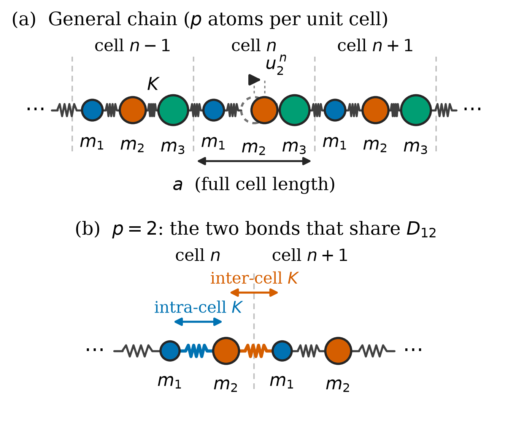

# Q3 theory: shared reading for the whole Q3 group

**Who reads this:** everyone in the Q3 group (Prasang, Haresh, Abhilash, Kumud, Abish). Nobody owns theory as a file, but
every file in the question implements part of it, and the examiner can ask anyone to derive
the basics. Know sections 1 to 4 at least.

Back to [README](../README.md).

## 1. 30-second version

> Each atom obeys Newton's law with spring forces from its two neighbours. Because the chain is
> periodic, solutions are plane waves times a cell-periodic amplitude (Bloch). Substituting turns
> infinitely many equations into one p×p Hermitian eigenvalue problem `D(q) e = ω² e`. Its p
> eigenvalues give 1 acoustic and p−1 optical branches.

## 2. The derivation, step by step (be able to write this on a board)

**Setup.** Unit cells of length `a`, each with `p` atoms of masses `m₁…m_p`. `u_j^n` = displacement
of atom j in cell n. Nearest neighbours joined by springs `K`.

**Step 1: equation of motion** (harmonic approximation: force linear in relative displacement)

```
m_j ü_j^n = K (u_{j+1}^n − u_j^n) + K (u_{j−1}^n − u_j^n)
```
Closure: `u_{p+1}^n ≡ u_1^{n+1}` and `u_0^n ≡ u_p^{n−1}` (the last atom of a cell bonds to the first
atom of the next cell).

**Step 2: Bloch ansatz**

```
u_j^n = (1/√m_j) e_j exp[i(q n a − ω t)]
```
The `1/√m_j` factor is a *choice*: it makes the matrix Hermitian (not just similar to one).

**Step 3: substitute.** For an interior atom (1<j<p):
`−ω² √m_j e_j = K(e_{j+1}/√m_{j+1} + e_{j−1}/√m_{j−1}) − 2K e_j/√m_j`
Multiply by `1/√m_j`:

```
ω² e_j = (2K/m_j) e_j − K/√(m_j m_{j+1}) e_{j+1} − K/√(m_j m_{j−1}) e_{j−1}
```
So `D_jj = 2K/m_j` and `D_{j,j±1} = −K/√(m_j m_{j±1})`.

**Step 4: the boundary atoms.** Atom p's right neighbour is atom 1 of cell n+1, which carries the
extra phase `e^{iqa}`. Atom 1's left neighbour is atom p of cell n−1 with `e^{−iqa}`:

```
D_{1,p} = −K e^{−iqa}/√(m₁ m_p),     D_{p,1} = conj(D_{1,p})
```
This is the **only q-dependent term**.

**Step 5: Hermitian ⇒ real ω².** `D(q)† = D(q)` so eigenvalues are real; mechanical stability makes
them ≥ 0.

## 3. Branch structure

- **Acoustic** (lowest): ω₁(0) = 0 because a rigid translation costs nothing; `D(0)` has the
  null vector `e_j ∝ √m_j`. Near q=0: `ω ≈ v_s |q|` with
  `v_s = a √(K / (p Σ m_j))`: p springs in series over length a carrying mass Σm.
- **Optical** (the other p−1): finite at q=0, atoms in a cell oscillate against each other with
  the centre of mass at rest.
- Brillouin zone: `q ∈ [−π/a, π/a]`.

## 4. Closed forms (used for validation)

- **p=1:** `ω = 2√(K/m) |sin(qa/2)|`.
- **p=2:** `ω±² = K/μ ± K √(1/μ² − 4 sin²(qa/2)/(m₁m₂))` with `1/μ = 1/m₁ + 1/m₂`.
  At the zone edge: `ω₋ = √(2K/m_>)`, `ω₊ = √(2K/m_<)`. The gap is set purely by mass contrast.

## 5. The two cautions the report makes (examiners like these)

1. **Convention of `a`.** Here `a` is the *full cell length*. Many textbooks use `a` = nearest-
   neighbour spacing (cell = 2a), so their `cos(qa)` is our `cos(qa/2)`. Mixing them gives a
   silent factor of 2.
2. **p=2: two bonds, one matrix element.** Atom 1 bonds to atom 2 twice (inside the cell and
   across the boundary), so `D₁₂ = −K(1 + e^{−iqa})/√(m₁m₂)`. Contributions must be *added*
   (`+=`), not overwritten. Overwriting leaves the acoustic branch non-zero at q=0, violating
   translational invariance. (This is the bug the validation suite caught.)


*Panel (a) the general chain; panel (b) the p=2 case with two bonds into one matrix element.*

## 6. Likely questions

- **Why Bloch's theorem?** The chain is invariant under translation by a, so eigenmodes can be
  chosen as simultaneous eigenfunctions of translation: phase factor `e^{iqa}` per cell.
- **Why only q in [−π/a, π/a]?** q and q+2π/a give the same `e^{iqna}`, so they describe the same
  motion. All distinct states live in one zone.
- **How many branches and why?** p, because D(q) is p×p. 3 atoms → 3 branches.
- **Why is D Hermitian?** The `1/√m` weighting makes the force matrix symmetric in a mass-
  weighted basis, and the Bloch phases appear as conjugate pairs.
- **Why is ω² ≥ 0?** The lattice is mechanically stable (positive K): the potential energy is
  positive-definite except for uniform translation (zero mode).
- **Where does the gap come from?** From mass contrast: at q=π/a the two sublattices decouple
  and have different natural frequencies `√(2K/m)`.
- **What if K differs per bond?** Replace K by `K_j` in each bond; `phonon.py` supports it.
- **What changes in 3D?** `q` becomes a vector, `D(q)` becomes 3p×3p (3 polarisations per atom).
  Out of scope here.

## 7. Check your understanding

On paper: derive `D(q)` for p=2 and show `D₁₂ = −K(1+e^{−iqa})/√(m₁m₂)`. Then show that
`det(D − ω²I) = 0` gives the diatomic formula. If you can do that you can defend the whole
section.

Source: report lines under `\section{Theory}`; code that implements it is `question_3/phonon.py`
(`dynamical_matrix`).
