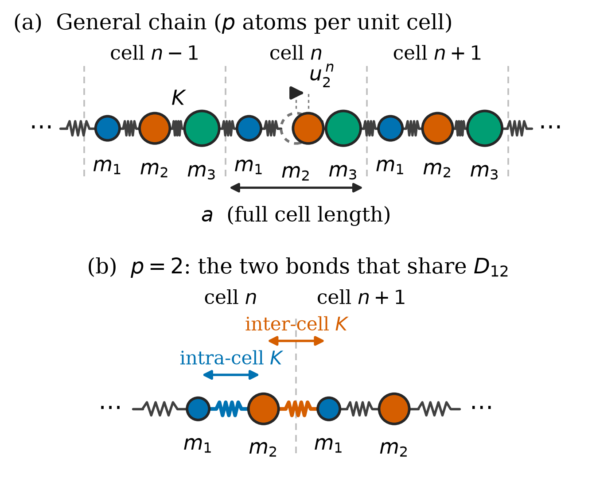
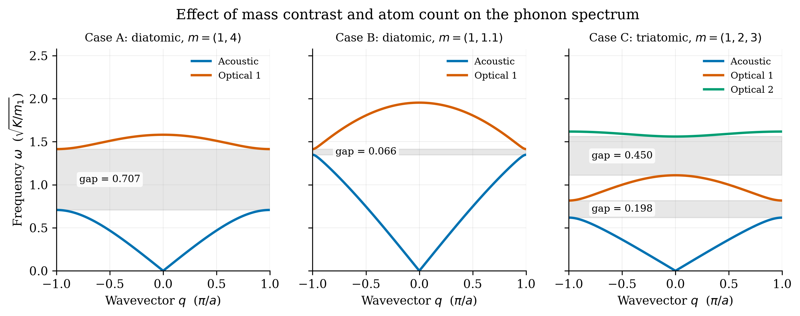
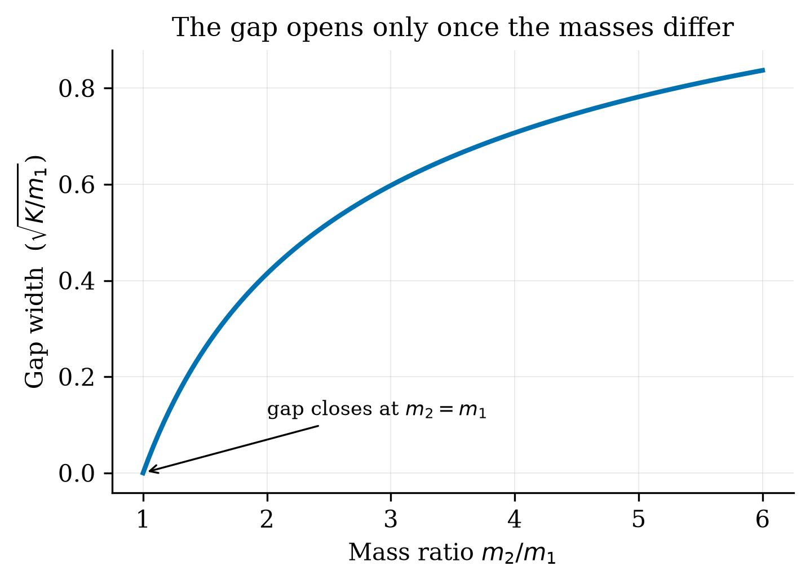
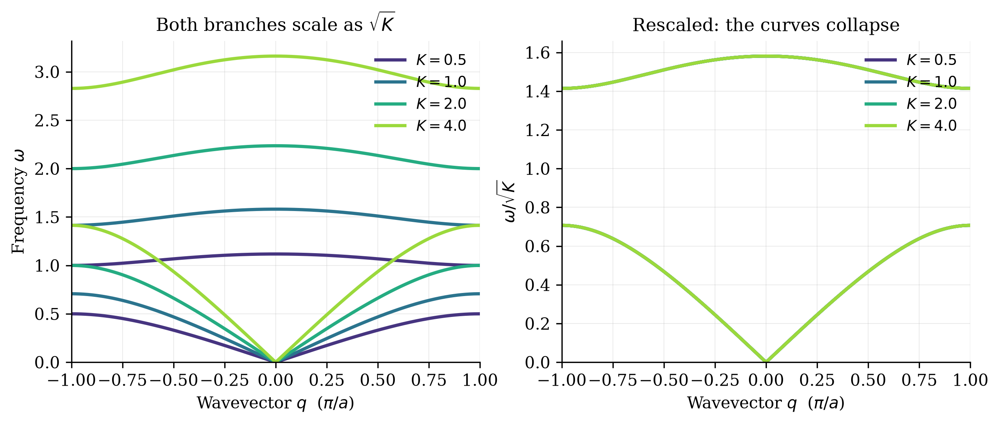
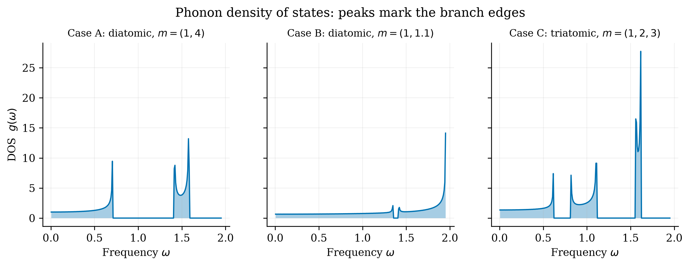
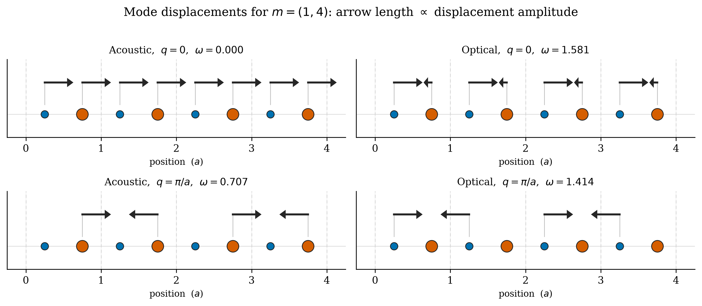

# Haresh: Q3 Results and Figures (`make_figures.py`, `_schematic.py`)

**Your part:** `question_3/make_figures.py` and `question_3/_schematic.py`: every figure in the
Q3 report, and what the Results section says about each one.

Back to [README](../README.md) · read [THEORY.md](THEORY.md) first: you know it already, and
the figures are the evidence for it.

## 1. 30-second version

> `make_figures.py` regenerates every figure in the Q3 report with one command, all from
> `phonon.py`. They show three things. Mass contrast opens the gap: wide for masses (1,4), nearly
> closed for (1,1.1), and two gaps for three atoms. The spring constant only scales every
> frequency by √K. Flat branches pile up into peaks in the density of states. `_schematic.py`
> draws the chain diagram in the Theory section.

## 2. What the script makes

Run `python make_figures.py`; it writes everything into `figures/`. The `__main__` block calls,
in order:

| Function | Output | Shows |
|---|---|---|
| `fig_schematic` | `schematic.png` | The model: (a) general p-atom chain, (b) p=2 with both bonds landing in one matrix element. Drawn by `_schematic.make` |
| `fig_cases` | `case_a/b/c.png` | Each case on its own, gaps shaded and labelled |
| `fig_modes` | `modes.png` | Case A displacement patterns at q=0 and q=π/a |
| `fig_comparison` | `comparison.png` | All three cases side by side, **same y-scale** |
| `fig_spring_sweep` | `spring_sweep.png` | Case A at K = 0.5, 1, 2, 4; then divided by √K |
| `fig_gap_vs_ratio` | `gap_vs_ratio.png` | Gap width against m₂/m₁ from 1 to 6 |
| `fig_validation` | `validation.png` | Numerical points on the analytic diatomic curve (used in Kumud's section) |
| `fig_dos` | `dos.png` | DOS for the three cases, **one common set of bins** |

The three required combinations live in one list at the top:
```python
CASES = [("case_a", [1.0, 4.0], 1.0, ...), ("case_b", [1.0, 1.1], 1.0, ...),
         ("case_c", [1.0, 2.0, 3.0], 1.0, ...)]
```

Code points to be able to explain:
- **`plot_dispersion()`** is shared by the case and comparison figures: it shades each gap with
  `axhspan`, labels its width, draws one line per branch and leaves headroom so the legend never
  hides a curve.
- **Common y-scale** (`_common_ymax`) in the comparison figure, so gap sizes can be compared by
  eye.
- **Spring sweep colours** use a light-to-dark blue ramp, not distinct colours, because K is an
  ordered quantity.
- **DOS bins:** one set of 241 edges for all three panels (width 8.1e-3). A van Hove peak's
  height grows as bins shrink, so heights are only comparable at a common width.
- **Mode arrows** show physical displacement `Re[u_j e^{iqna}]` with `u_j = e_j/√m_j`. The arrow
  head scales with arrow length, so the 4:1 amplitude ratio stays readable.
- **`_schematic.py`** draws atoms as circles with radius ∝ m^{1/3} (so area tracks mass) and
  zigzag springs from atom edge to atom edge. It is imported by `make_figures.py`, not run on
  its own.
- Everything uses `common/style.py`, so the figures match the app and the Q5 report.

## 3. Results you must know cold

All in units of √(K/m₁), with K=1, a=1.

| Case | Masses | Acoustic max | Optical range | Gap | v_s |
|---|---|---|---|---|---|
| A | (1, 4) | 0.7071 | 1.4142–1.5811 | 0.7071 | 0.3162 |
| B | (1, 1.1) | 1.3484 | 1.4142–1.9540 | 0.0658 | 0.4880 |
| C | (1, 2, 3) | 0.6180 | 0.8165–1.1101 and 1.5602–1.6180 | 0.1985, 0.4501 | 0.2357 |

Eigenfrequencies (q=0 → q=π/a):
- A: acoustic 0 → 0.7071; optical 1.5811 → 1.4142
- B: acoustic 0 → 1.3484; optical 1.9540 → 1.4142
- C: acoustic 0 → 0.6180; optical 1 1.1101 → 0.8165; optical 2 1.5602 → 1.6180

**The story in three sentences**
1. **Case A:** at the zone edge the two sublattices decouple. In the acoustic mode only the heavy
   atoms move (ω = √(2K/m₂) = 0.7071); in the optical mode only the light ones (ω = √(2K/m₁) =
   1.4142). Gap = the difference = 0.7071.
2. **Case B:** a 10% mass difference leaves a tiny gap (0.0658), which closes continuously as
   m₂→m₁. The gap comes from the two-atom basis; there is no threshold ratio.
3. **Case C:** p=3 gives 1 acoustic + 2 optical branches and 2 gaps. The top branch is nearly flat
   (width 0.058), so its group velocity ≈ 0 and the DOS has its tallest peak there.

**K-sweep:** `D ∝ K`, so ω ∝ √K. Dividing by √K collapses all four curves onto one. Masses set the
*structure* of the spectrum, K only sets its *scale*.

**DOS:** `g(ω)` counts modes per unit frequency, normalised so ∫g dω = p. It is zero in the gaps.
Peaks (van Hove singularities) occur where a branch has zero slope: q=0, q=π/a, and flat
branches. The bin-independent version of "Case C has the tallest peak": its top branch spans only
0.058, about 3× narrower than the next-narrowest (Case A optical, 0.167).

**Eigenfrequencies:** at q=0 the acoustic mode is a rigid translation (ω=0) and the optical mode
has the atoms moving against each other with the centre of mass fixed. For Case A that
frequency is √(2K/μ) = 1.5811, where μ is the reduced mass. At q=π/a neighbouring cells move
in antiphase.

## 4. Figures


*The model. Panel (b): for p=2 both bonds join atoms 1 and 2, so both land in D₁₂ and must be
added.*


*Three cases on a common scale. Shaded = forbidden frequencies.*


*Gap grows monotonically from 0 at m₂=m₁.*


*Left: Case A at four K. Right: divided by √K, all collapse.*


*DOS per case, common bins; empty regions are the gaps.*


*m=(1,4). At q=π/a the eigenvectors are exactly (0,1) and (1,0), so only one sublattice moves.
That needs m₁ ≠ m₂: with equal masses the two frequencies coincide and the pattern isn't unique.*

## 5. Likely questions

- **Why does the gap close for equal masses?** The cell is then really a monatomic chain of
  period a/2; the "optical" branch is the acoustic one folded back.
- **What is a gap physically?** A frequency range with no travelling wave at any q. A wave driven
  at that frequency decays and is reflected.
- **Why does the light atom swing four times further in the optical mode at q=0?** The centre of
  mass stays at rest: m₁u₁ + m₂u₂ = 0, so u₁/u₂ = m₂/m₁ = 4.
- **Why √(2K/μ) and not √(K/μ) like two masses on one spring?** Each atom sits between *two*
  springs, and both stretch equally in this mode, so the restoring force doubles.
- **What does the DOS tell you that the dispersion doesn't?** How many modes sit at each
  frequency. A flat branch puts a whole branch's worth of states into a narrow window.
- **Why can't you read the DOS peak height as a number?** It's a histogram of a function that
  diverges as 1/√(ω−ω₀); the height depends on the bin width.
- **Why plot all three cases on one y-scale?** So the gap sizes can be compared directly.
- **Where does a figure's data come from?** Always `phonon.py`; `make_figures.py` only plots.
- **How do you regenerate a figure?** `python make_figures.py`, one command for all of them.

## 6. Run it yourself

```bash
cd question_3
../.venv/bin/python make_figures.py      # rewrites every PNG in figures/
../.venv/bin/python -c "
import phonon as ph
for m in ([1,4],[1,1.1],[1,2,3]):
    q,w = ph.dispersion(m); print(m, [round(g[3],4) for g in ph.band_gaps(w)])
"
```
The second command prints the gap widths in the results table. Try `[1,1]` and get no gaps.
