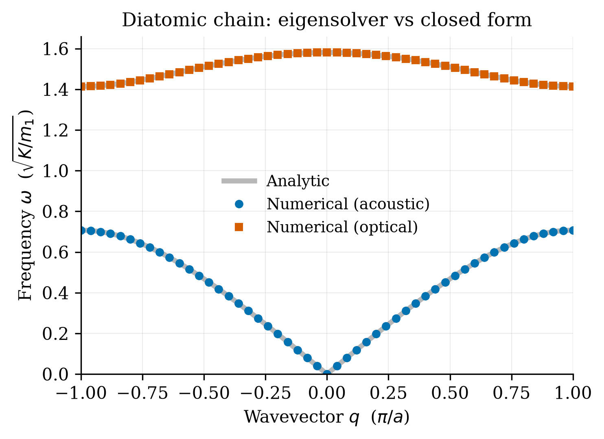

# Kumud: Q3 Validation (`test_phonon.py`)

**Your part:** `test_phonon.py` and the report §Validation.

Back to [README](../README.md).

> **Version note:** the working-tree `test_phonon.py` has 7 checks (extra edge cases); the committed version and the report have 5. See the README heads-up.

## 1. 30-second version

> We don't trust a general-purpose code just because the plot looks plausible. `test_phonon.py`
> compares it against every case that has a closed-form answer: the monatomic and diatomic
> chains, the sound velocity, the acoustic zero at q=0, and gap closure for equal masses. All
> five tests pass, with errors around 1e-14. The suite already caught one real bug.

## 2. The five tests (current run: **5/5 pass**)

| # | Test function | What it checks | Result |
|---|---|---|---|
| 1 | `test_diatomic` | General code at p=2 vs `diatomic_exact`, m=(1,4), over the whole zone | 4.5e-14 |
| 2 | `test_monatomic` | (a) p=1 vs `2√(K/m)|sin(qa/2)|`; (b) three equal masses in a cell of length 3a must equal the monatomic branch *folded* at matched q | 1.6e-15; 3.5e-14 |
| 3 | `test_sound_velocity` | Slope of ω₁(q) near q=0 (polyfit on first 5 points) vs analytic `v_s`, for p=2, 3, 1 | 1.6e-8 relative |
| 4 | `test_acoustic_zero` | ω₁(q=0) = 0 for several masses | 0 exactly |
| 5 | `test_gap_closure` | Equal masses → 0 gaps; unequal masses → exactly 1 gap | pass |

The report table lists six rows because monatomic and zone-folding are shown separately.

> **Stale number in the report.** The report's table gives the zone-folding error as 1.4e-4. The
> current test compares at *matched q* and gets 3.5e-14. The test passes either way. Quote the
> new value or just say "to machine precision".

## 3. Why each test is meaningful

1. **Diatomic vs closed form.** The textbook formula is an independent derivation (2×2
   determinant), so agreement tests the whole pipeline, including the inter-cell phase.
2. **Monatomic limit.** p=1 hits the special-case branch (both bonds on the diagonal), which the
   p≥2 code never exercises. *Zone folding:* 3 equal atoms in a cell of 3a is physically a
   monatomic chain, so each q gives three frequencies equal to the monatomic ones at
   `q + 2πn/(3a)`, n = −1, 0, 1. Comparing at matched q pins the frequency-to-wavevector map,
   not just the *set* of frequencies.
3. **Sound velocity.** Tests the long-wavelength limit independently of closed forms; also works
   for p=3 where no closed form exists.
4. **ω₁(0)=0.** Translational invariance. Fails if bonds are overwritten instead of added.
5. **Gap closure.** Qualitative physics: gap ⇔ mass contrast.

## 4. The bug the suite caught (tell this story)

The intra-cell and inter-cell contributions to `D[0,1]` at p=2 were being **overwritten** rather
than **accumulated** (`=` vs `+=`). The result still gave a plausible-looking plot, but the
acoustic branch was non-zero at q=0, violating translational invariance. Tests 1 and 4 flagged
it. Moral: plots can look right while being wrong; closed-form checks are not decorative.

## 5. Helper code in the test file

```python
def check(name, ok, detail=""):
    print(f"[{'PASS' if ok else 'FAIL'}] {name}" + ...)
    return ok
```
Each test returns a bool; `__main__` runs all, prints `n/5 checks passed`, and exits non-zero on
any failure (so it could be wired into CI).

Tolerances: 1e-10 for exact-formula comparisons; 1e-3 for the slope test (finite-difference
accuracy); 1e-8 for the zero mode.


*Numerical points (markers) sit on the analytic diatomic curves (grey) over the whole zone.*

## 6. Likely questions

- **Why is p=3 not validated against a formula?** No simple closed form for p≥3; we validate via
  the folding test (equal masses), the sound velocity and the q=0 zero, which all work for any p.
- **Why 1e-10 and not exactly zero?** Floating point; errors are ~1e-14, so 1e-10 has plenty of
  headroom without being vacuous.
- **Why is the slope test only 1e-3?** A finite-difference slope at small but non-zero q has
  O(q²) error; the actual result is 1.6e-8.
- **Do passing tests prove it's correct?** They prove it matches known limits. They don't prove
  every case, but a bug in the general assembly would almost certainly break one of them.
- **What does the folding test prove that the plain monatomic test doesn't?** That the p>1 code
  handles the unit-cell geometry (cell length 3a, Bloch phase per cell) correctly.
- **What would a failing test look like?** `[FAIL] diatomic vs closed form  max err 1.2e+00` and
  exit code 1.

## 7. Run it yourself

```bash
cd question_3
../.venv/bin/python test_phonon.py       # expect 5/5
```
Then break it on purpose (in a scratch copy): change `+=` to `=` on `D[0, -1]` in `phonon.py`,
rerun, note which tests fail, and revert.

Also be ready to explain `diatomic_exact` (in `phonon.py`): the cancellation-safe form of ω₋².
