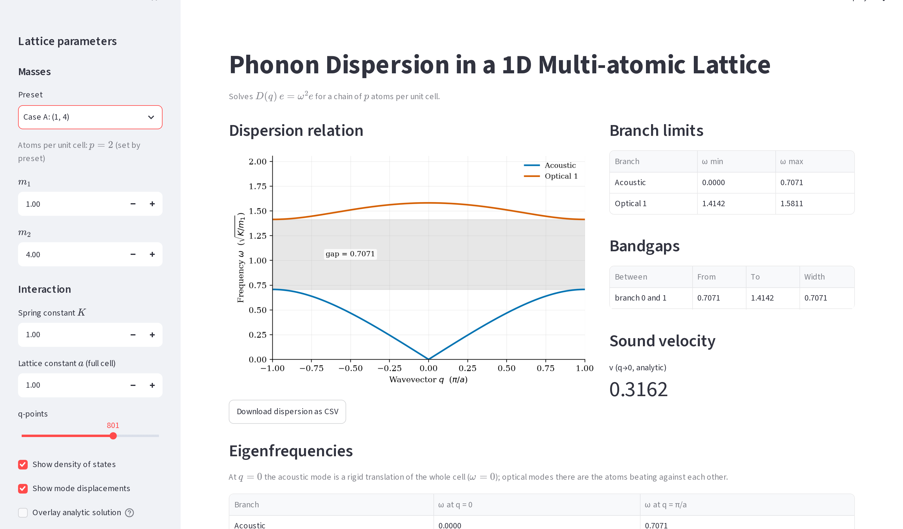

# Prasang: Q3 Interface (`app.py`) and the combined app

**Your part:** `question_3/app.py`, `question_3/_shots.py`, and the shared files that serve both
apps: `streamlit_app.py`, `home.py`, `common/style.py`.

Back to [README](../README.md) · read [THEORY.md](THEORY.md) for the physics the app shows.

## 1. 30-second version

> The app takes the number of atoms `p`, their masses, `K` and `a`, builds the p×p dynamical
> matrix at every q, diagonalises it, and plots the p branches. It shades the gaps and gives
> tables of branch limits and of eigenfrequencies at q=0 and q=π/a. It also draws the DOS and
> the mode displacement patterns. All the physics comes from `phonon.py`; the app is a thin
> wrapper that reads inputs, calls it and draws the results. `streamlit_app.py` puts the Q3 and
> Q5 apps behind one sidebar, and `_shots.py` drives a headless browser to take the report
> screenshots.

## 2. `app.py`, top to bottom

| Section | What it does |
|---|---|
| Path setup | Adds `common/` and `question_3/` to `sys.path` **once** (Streamlit reruns the script on every widget change, so a plain insert would grow the list forever) |
| Sidebar | Preset (Custom / Case A / B / C), `p` slider (1–5, hidden when a preset fixes it), one mass field per atom, `K`, `a`, q-points, toggles for DOS, modes, analytic overlay. Masses and K ≤ 1e4, a ≤ 1e3 |
| Solve | `solve()` wraps `ph.dispersion`, cached with `st.cache_data`. A `ValueError` (unstable or non-finite input) shows `st.error` and `st.stop()` instead of crashing. Then `ph.band_gaps`, `ph.branch_limits`, `ph.is_folded` |
| Dispersion plot | Gaps shaded with `axhspan` and labelled with width; one colour per branch from `style.branch_colors`; optional analytic overlay for p ≤ 2; CSV download. y-axis says "input units" |
| Tables | Branch limits, bandgaps (or a note: p=1 has one branch; equal masses close the gap), analytic sound velocity |
| Eigenfrequencies | `ph.frequencies_at` at q=0 and q=π/a |
| DOS | `ph.dos`, histogram of ω over a dense q mesh; caption says read peak positions, not heights |
| Mode displacements | `ph.modes` gives eigenvectors; draws `Re[u_j e^{iqna}]` as arrows over 4 cells; warns if the branch is degenerate at that q |

Design points to be able to explain:
- **The key on the mass inputs includes the preset** (`key=f"m_{preset}_{j}"`). A keyed
  Streamlit widget ignores `value=` once it exists, so without the preset in the key, switching
  preset would keep the old masses.
- **Presets fix `p`**, so the slider is hidden rather than allowed to disagree.
- **Caching.** `@st.cache_data` on `solve()` means moving an unrelated control (say, the mode
  q slider) doesn't recompute the dispersion. Masses go in as a tuple because cache keys must be
  hashable.
- **Errors, not crashes.** Bad input (e.g. something that makes ω² negative) is caught and shown
  as a message.
- **Arrows show physical displacements** `u_j = e_j/√m_j`, not the mass-weighted `e_j`. That is
  why the light atom moves more in the optical mode.
- **Equal masses → "Folded acoustic", not "Optical".** With all masses equal the real period is
  a/p, so the upper branches are the acoustic branch folded back into the smaller zone. The app
  labels them that way and explains why.
- **Degenerate modes.** Equal masses at q=π/a give two equal frequencies; any mix of the two
  patterns is valid and the solver picks one arbitrarily. The app warns rather than presenting
  the picture as unique.
- **Figures are `matplotlib.figure.Figure` objects, not pyplot.** pyplot keeps global state;
  a rerun that fails halfway would leak figures. A `Figure` is just garbage-collected.
- **"Input units" on the y-axis.** The app plots √(K/m) for whatever numbers you type. The
  report's results use K = m₁ = 1, so there the numbers *are* in units of √(K/m₁). In the app,
  with say m₁ = 4, that label would be wrong.

## 3. Numbers the app shows for the presets (K=1, a=1)

You don't own the results write-up (Haresh does), but you will demo these, so know them.

| Case | Masses | Acoustic max | Optical range | Gap | v_s |
|---|---|---|---|---|---|
| A | (1, 4) | 0.7071 | 1.4142–1.5811 | 0.7071 | 0.3162 |
| B | (1, 1.1) | 1.3484 | 1.4142–1.9540 | 0.0658 | 0.4880 |
| C | (1, 2, 3) | 0.6180 | 0.8165–1.1101 and 1.5602–1.6180 | 0.1985, 0.4501 | 0.2357 |

## 4. The shared files

### `streamlit_app.py`: one app, two questions
```python
pages = [st.Page("home.py", ..., default=True),
         st.Page("question_3/app.py", ..., url_path="phonons"),
         st.Page("question_5/app.py", ..., url_path="fermi-dirac")]
st.navigation(pages).run()
```
- Streamlit's multi-page API: each question's app runs as a page.
- **`url_path` is required** because both scripts are called `app.py`; Streamlit would otherwise
  give both pages the same URL.
- Only the entry script may call `st.set_page_config`. That's why each `app.py` wraps its own
  call in `try/except`: it works when run alone and is a harmless no-op as a page.
- This is also the file you'd point Streamlit Community Cloud at to deploy.

### `home.py`
The landing page: a two-column summary of Q3 and Q5 and a link to the repo. No computation.

### `common/style.py`
Shared matplotlib defaults so all figures in both reports look like one document.
- **Okabe–Ito palette**, checked for colour-vision deficiency. Acoustic is always blue
  (`#0072B2`), optical branches take the next colours in a fixed order (never cycled), gaps are
  grey.
- Branch identity is carried by colour **and** legend/labels, never colour alone.
- `apply()` sets serif fonts (to match the LaTeX body), light grid, no top/right spines,
  300-dpi saves with tight bounding boxes.
- `matplotlib.use("Agg")`: a non-interactive backend, so figure scripts run on a server with no
  display.

### `_shots.py`: report screenshots
- Uses **Playwright** to open the running app in headless Chromium (1500 px wide, 2× scale).
- For each preset (Case A, B, C) it opens the first combobox in the sidebar, picks the preset,
  waits for Streamlit to finish rerunning (`settle`: network idle plus a few seconds), and saves
  a full-page screenshot to `figures/ui_case_*.png`.
- `trim()` crops the blank band below the content, measuring only the main panel (the
  sidebar is a full-height grey block and would defeat the crop).
- The report uses `ui_case_a_top.png` and `ui_case_c_top.png`, which are top-of-page crops.
  No script in the repo makes those crops, so if asked, say they were cropped separately.
- Underscore prefix = a helper, not part of the physics.


*These screenshots were taken before the review fixes: the live app's y-axis now reads "input
units", and equal masses show "Folded acoustic". The numbers are the same.*

## 5. Likely questions

- **How does the app get its numbers?** Every number comes from `phonon.py`. The app does no
  physics of its own.
- **How do you know the app is right?** `phonon.py` is checked against the monatomic and
  diatomic closed forms to ~1e-14 (Kumud's `test_phonon.py`). In the app, tick "Overlay analytic
  solution" for p ≤ 2 and the curves sit on top of each other.
- **Why Streamlit?** Interactive widgets in pure Python, no front-end code; it reruns the script
  on every change, which suits a model this cheap.
- **Isn't recomputing on every change slow?** n_q diagonalisations of a ≤5×5 matrix take
  milliseconds, and results are cached anyway.
- **What happens with a negative or zero spring constant?** Inputs have a minimum of 0.01. If
  anything still gives ω² < 0, `phonon.py` raises an error and the app shows it.
- **Why does the light atom swing four times further in the optical mode at q=0?** The centre
  of mass must stay at rest: m₁u₁ + m₂u₂ = 0, so u₁/u₂ = m₂/m₁ = 4.
- **Why does the acoustic branch start at zero?** A uniform shift of all atoms stretches no
  spring, so it costs no energy.
- **How were the screenshots made?** `_shots.py`, with Playwright driving a headless browser.
- **Why do both apps look the same?** `common/style.py` sets one palette and font for both.
- **Did you write this with AI?** See the README ground rules. Answer honestly, then show you
  understand the code in section 2.

## 6. Run it yourself

```bash
.venv/bin/streamlit run streamlit_app.py            # both questions, one sidebar
cd question_3 && ../.venv/bin/streamlit run app.py  # Q3 alone
```
Demo route: Case A → Case C (watch the mass fields and the second gap appear). Then Custom with
masses (1, 1): the gap vanishes and the branches become "Folded acoustic". In Mode displacements,
move q to 1.0 to see the degeneracy warning. Finally, double K and watch every frequency grow
by ×1.414.

Screenshots (needs `pip install playwright && playwright install chromium`):
```bash
cd question_3 && ../.venv/bin/streamlit run app.py --server.port 8520 &
../.venv/bin/python _shots.py
```
