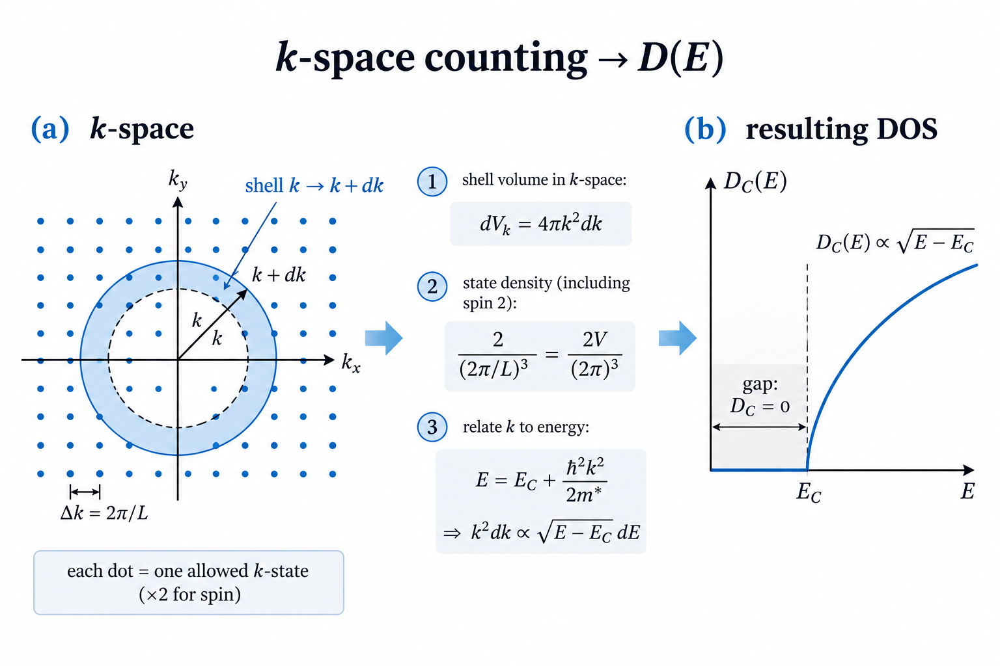

# Q5 theory: shared reading for the whole Q5 group

**Who reads this:** everyone in the Q5 group (Naman, Guhan, Nithin, Praveen, Kshiteesh). Nobody owns theory as a file, but
every file in the question implements part of it, and the examiner can ask anyone to derive
the basics. Know sections 1 to 4 at least.

Back to [README](../README.md).

## 1. 30-second version

> Electrons are fermions, so the occupation of a state of energy E is the Fermi–Dirac function
> `f(E)`. The number of states per energy is the DOS `D(E) ∝ √(E−E_c)`. Integrating `D·f` gives
> the carrier density `n`, which fixes the chemical potential `μ`. At low `n` the gas is classical
> (Boltzmann); at high `n` it is degenerate (Fermi sphere). `E_F` is `μ` at T=0, and the thing
> that varies with T is `μ(T)`.

## 2. Fermi–Dirac statistics

```
f(E) = 1 / ( exp[(E − μ)/k_BT] + 1 )
```
- `f(μ) = 1/2` at **every** temperature.
- As T→0, `f` becomes a step: filled below μ, empty above.
- Pauli principle ⇒ at most one electron per state (per spin), so `f ≤ 1`.
- Smearing width is about `k_BT` (≈26 meV at 300 K).

## 3. Density of states (derive on a board)

1. Box of side L with periodic boundary conditions ⇒ allowed k on a grid of spacing `2π/L`, so
   `(L/2π)³` states per unit volume of k-space per unit volume of real space, ×2 for spin.
2. Shell of radius k, thickness dk: volume `4πk² dk`.
3. States per volume in the shell: `2 · 4πk² dk / (2π)³ = k² dk / π²`.
4. Effective-mass dispersion `E = E_c + ħ²k²/2m*` ⇒ `k = √(2m*(E−E_c))/ħ`,
   `dk = (1/ħ)√(m*/2(E−E_c)) dE`.
5. Result:

```
D(E) = (1/2π²) (2m*/ħ²)^{3/2} √(E − E_c),     E ≥ E_c   (zero in the gap)
```
The square-root onset is the 3D signature.



## 4. Carrier density and μ

```
n = ∫_{E_c}^{∞} D(E) f(E) dE
```
One equation, one unknown μ (given n, T, m*). Substituting `x=(E−E_c)/k_BT`, `η=(μ−E_c)/k_BT`:

```
n = N_c · (2/√π) · F_{1/2}(η),     F_{1/2}(η) = ∫₀^∞ √x /(1 + e^{x−η}) dx
N_c = 2 (m* k_BT / 2πħ²)^{3/2}
```
Why this form: all dimensional factors sit in `N_c`; the integral is dimensionless and the cutoff
is a multiple of k_BT.

## 5. The two limits

| | Non-degenerate (η ≪ −1) | Degenerate (η ≫ 1) |
|---|---|---|
| Approximation | drop the +1 in `f` | `F_{1/2}(η) → (2/3) η^{3/2}` |
| Result | `n = N_c exp[(μ−E_c)/k_BT]` (Boltzmann) | `E_F = ħ²(3π²n)^{2/3}/2m*` |
| μ position | below the band edge | above the band edge |
| Fermi surface? | none | yes |

Degenerate-gas quantities (a filled Fermi sphere):
`k_F = (3π²n)^{1/3}`, `v_F = ħk_F/m*`, `T_F = E_F/k_B`.

**Multi-valley materials (Si, Ge).** The conduction band has `M_c` equivalent ellipsoidal valleys
(6 in Si, 4 in Ge) with masses `m_l` (long axis) and `m_t` (short axes). The density-of-states
mass `m_de = M_c^{2/3}(m_l m_t²)^{1/3}` gives the right `N_c` and `E_F`. But each valley holds
only `n/M_c`, so its mean Fermi radius is `(3π²n/M_c)^{1/3}`, smaller by `M_c^{1/3}`, and the Fermi
velocity depends on direction: `v_i = ħk_i/m_i` with `ħ²k_i²/2m_i = E_F`. Si at 1e20 cm⁻³:
`k_F` 0.79 rather than 1.44 nm⁻¹; `v_F` 1.6 and 3.7 × 10⁵ m/s along the long and short axes.

## 6. The two "points of care": **say these in the viva**

1. **`E_F` is not `μ(T)`.** They coincide only at T=0. `E_F` depends on `n` alone; what moves with
   temperature is `μ(T)`. "Fermi level versus T" in the question really means `μ(T)`.
   *Example:* n=1e16 cm⁻³ GaAs: `μ` falls by 0.3 eV across the T range while `E_F` stays 2.5 meV.
2. **`k_F, v_F, T_F` presuppose degeneracy.** For GaAs at n=1e16 cm⁻³, `T_F = 29 K` ≪ 300 K, i.e.
   the gas is *not* degenerate, so these are formal numbers. The app shows η beside them.

## 7. Key numbers (GaAs, 300 K)

| n (cm⁻³) | μ−E_c (meV) | η | E_F (meV) | T_F (K) |
|---|---|---|---|---|
| 1e16 | −97.3 | −3.77 | 2.5 | 29 |
| 1e18 | +41.9 | 1.62 | 54.4 | 632 |
| 1e19 | +250.4 | 9.69 | 252.6 | 2931 |

`N_c(GaAs, 300 K) = 4.35e17 cm⁻³`: the classical/degenerate crossover is near `n ~ N_c`.

## 8. Likely questions

- **Why is the DOS √E?** Spherical k-space counting: states ∝ k³ ∝ E^{3/2}; derivative gives √E.
- **Why is `f(μ)=1/2` always?** Plug E=μ: `1/(e⁰+1)`.
- **Why does μ fall as T rises?** `D(E)` grows with E, so more states are above μ than below
  within the thermal window; carriers are promoted upward and μ must drop to keep n fixed.
- **When is Boltzmann OK?** When `η ≪ −1`, i.e. `n ≪ N_c`. Quantitatively it is 1.7 % off at
  η = −3 and 4.7 % at η = −2, which is why the app's "non-degenerate" banner starts at η < −3.
- **What is `N_c`?** The effective number of states at the band edge available at temperature T.
- **Why is the gas non-degenerate in a normal doped semiconductor?** `n` is far below `N_c` (≈1e16 vs
  4e17), so `E_F ≪ k_BT`.
- **Why does doping stop at 1e19?** Beyond that, E_F reaches the L/X satellite valleys of GaAs
  (0.29 and 0.48 eV), so a single parabolic Γ valley is no longer the right model.
- **Spin?** Counted as the factor 2 in the DOS.
- **Valence band/holes?** Outside the model (n-type, conduction band only). Two consequences
  to know: at low n and high T the fixed-n solution can put μ *below* E_v (a contradiction;
  really, holes take over and μ sits near mid-gap); and as T→0 there is no freeze-out (really,
  donors recapture electrons and μ sits between E_d and E_c). The app warns in both cases. The
  fix is to solve charge neutrality `n − p = N_D⁺` with a valence band and a donor level.

## 9. Check yourself

Derive `D(E)` from scratch, then show that dropping the +1 in `f` gives `n = N_c e^{(μ−E_c)/kT}`.
Source: report `\section{Theory}`; code: `question_5/fermi.py` (`dos`, `n_c`, `fermi_quantities`).
