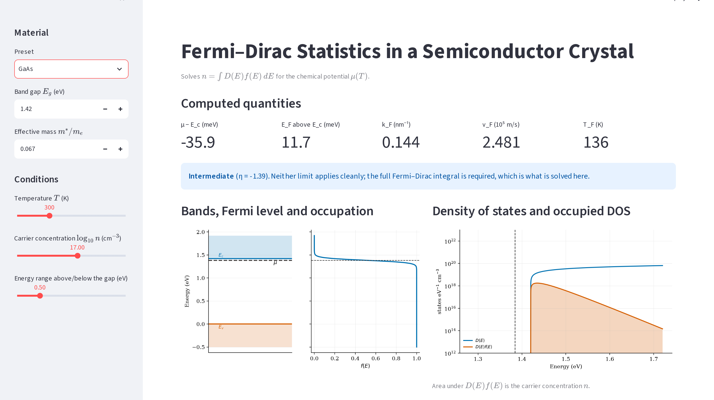

# Kshiteesh: Q5 Interface Section and Assembly

**Your part:** report §Interface (inputs, outputs, degeneracy flag, GaAs/Si/Ge screenshots),
conclusions, references, appendix listings, final build.

Back to [README](../README.md).

> The interface code (`app.py`) was written by Prasang. Your job is to **know it and explain it**:
> run it, understand what each control does, and what each output means. You are also the
> person with the broadest view of the Q5 report.

## 1. 30-second version

> The Streamlit app takes the band gap, effective mass, temperature, carrier concentration and an
> energy range, with presets for GaAs, Si and Ge. It solves for μ with the full Fermi–Dirac
> integral, shows μ−E_c, E_F, k_F, v_F, T_F with a regime banner (via η), and plots the band
> diagram with f(E), D(E) with its occupied part, and μ against T and n. Nothing is approximated
> for speed.

## 2. The app (`question_5/app.py`)

| Control | Meaning |
|---|---|
| Preset | GaAs (1.42 eV, 0.067), Si (1.12, 1.08), Ge (0.66, 0.56). Masses are density-of-states masses |
| Band gap `E_g`, mass `m*/mₑ` | Editable; keyed on the preset so changing preset updates them |
| `T` slider | 1–1000 K |
| `log₁₀ n` slider | 12–21 (cm⁻³), steps of 0.1 |
| Energy range | How far above/below the gap to draw |

**Outputs**
- Five metrics: `μ−E_c` (meV), `E_F` above E_c (meV), `k_F` (nm⁻¹), `v_F` (10⁵ m/s), `T_F` (K).
- **Regime banner** from `η = (μ−E_c)/k_BT`:
  - `η > 2`: **degenerate** (green), so k_F, v_F, T_F are physical.
  - `η < −2`: **non-degenerate** (amber), μ below the edge, Boltzmann; k_F, v_F, T_F are formal.
  - otherwise **intermediate**: need the full integral.
- Left plot: band edges + μ, next to `f(E)` on the same energy axis.
- Right plot: `D(E)` and `D(E)f(E)` on a log axis, area = n.
- Two sweeps: `μ−E_c` vs T (marker = current T, dotted = E_F) and vs n (marker = current n).



Presets screenshots: `figures/ui_gaas.png`, `ui_si.png`, `ui_ge.png`. In the report the GaAs run
is n=1e17, 300 K, banner η = −1.39 (neither limit applies cleanly).

## 3. Software flow (be able to say it)

`n = 10**log_n * 1e6` (m⁻³) → `solve_mu` → `η` → `fermi_quantities` → banner/metrics →
plots using `fermi_dirac` and `dos` → sweeps call `solve_mu` 90 times each. The app is a thin
wrapper over `fermi.py`.

## 4. Conclusions (report §Conclusions): five bullets

1. Classical/degenerate boundary is near `n ~ N_c` (4.35e17 cm⁻³ for GaAs at 300 K); equivalently
   degeneracy needs `T ≪ T_F`.
2. μ falls with T because `D(E) ∝ √(E−E_c)` offers more states above μ than below.
3. In the degenerate regime that fall is the `T²` Sommerfeld correction.
4. μ rises logarithmically with n while non-degenerate and as `n^{2/3}` once degenerate.
5. Effective mass, not band gap, controls how readily a material becomes degenerate.

**Limitations stated:** single isotropic parabolic valley (DOS masses make N_c right but k_F, v_F
describe one equivalent sphere); GaAs L/X valleys limit the doping range to ≤1e19; band
non-parabolicity ignored; no valence band, no dopant-ionisation statistics; n is an input, not
solved from dopant levels.

## 5. References (inline `thebibliography` in `report.tex`)

| Key | Source | Used for |
|---|---|---|
| kittel | Kittel, *Intro to Solid State Physics*, 8th ed., ch. 6 | Free-electron Fermi gas |
| ashcroft | Ashcroft & Mermin, ch. 2 and ch. 28 | Sommerfeld theory, semiconductors |
| sze | Sze & Ng, *Physics of Semiconductor Devices*, ch. 1 | Carrier statistics |
| blakemore | Blakemore, *Solid-State Electronics* 25, 1067 (1982) | Fermi–Dirac integral approximations |
| scipy | Virtanen et al., *Nature Methods* 17, 261 (2020) | `quad`, `brentq` |
| numpy | Harris et al., *Nature* 585, 357 (2020) | Arrays |
| streamlit | Streamlit docs | Interface |

(`reportNotes.bib` only contains RevTeX control entries; references are typed in `report.tex`.)

## 6. Assembly

- RevTeX 4-2 (`aps, prb, reprint`); `latexmk -pdf report.tex` inside `report/`.
- Appendix uses `\lstinputlisting` to include `fermi.py`, `test_fermi.py`, `make_figures.py`,
  `app.py` directly, so listings can't drift from the code.
- Figures from `question_5/figures/*.png`.

## 7. Project map for Q5 (so you can answer at overview level)

| Piece | File | Owner |
|---|---|---|
| Theory | report §Theory | Guhan |
| Numerical core | `fermi.py` | Naman |
| Validation (6 checks) | `test_fermi.py` | Nithin |
| Results and figures | `make_figures.py`, §Results | Praveen |
| Interface section, conclusions, build | `app.py` (explainer), `report.tex` | You |

## 8. Likely questions

- **What do the inputs do?** (Table above.) T and n change μ; m* sets N_c and the DOS; E_g only
  shifts E_c (it doesn't change μ−E_c).
- **Why does the banner use η?** η compares μ−E_c with k_BT: the actual criterion for degeneracy.
- **Why show k_F, v_F, T_F in the non-degenerate regime?** The question asks for them. We show
  them, flagged as formal.
- **Is anything approximated in the app?** No: the full integral is solved at every slider change
  and at every sweep point.
- **Why do the Si/Ge presets use different masses from the textbook values?** They're
  density-of-states masses (valley degeneracy included); conductivity masses are smaller.
- **Why does μ−E_c not depend on E_g?** In this model E_c is just the reference; only m*, n and T
  matter.
- **Main limitation?** Single parabolic valley, conduction band only.
- **How would you extend it?** Add holes/valence band and solve charge neutrality with dopant
  levels (`n = p + N_d⁺`), non-parabolic bands, multiple valleys.

## 9. Run it yourself

```bash
cd question_5
../.venv/bin/streamlit run app.py
```
Do this: GaAs, 300 K, log n = 16 → 17 → 19 and watch the banner change; switch to Si and note
μ−E_c drops at the same n; then set T=1 and check μ ≈ E_F.
