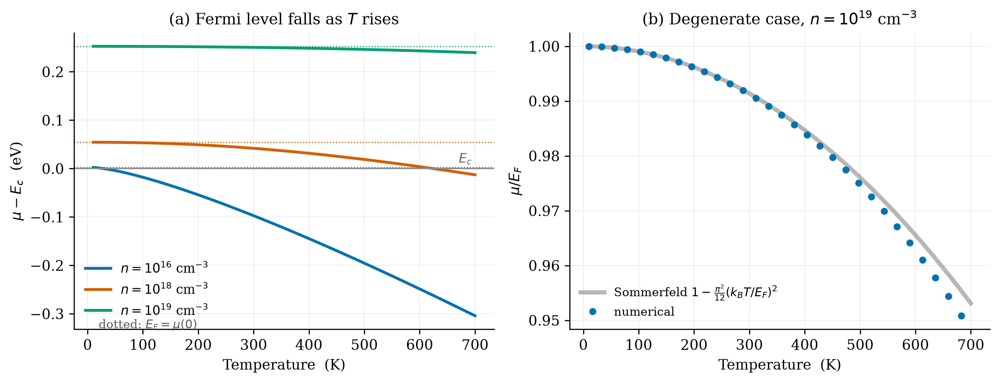

# Nithin: Q5 Validation (`test_fermi.py`)

**Your part:** `test_fermi.py` and the report §Validation.

Back to [README](../README.md).

## 1. 30-second version

> `fermi_integral_half` and `solve_mu` are general numerical code, so we test them where the
> answer is known: the Boltzmann limit (including the first Fermi–Dirac correction to it), the
> T→0 limit, an exact round trip, `f(μ)=1/2`, the Sommerfeld expansion for μ(T), and `F_{1/2}`
> itself against independent series. All nine checks pass. The strongest are the Sommerfeld
> comparison (3.6e-9), which tests the temperature dependence quantitatively, and the Boltzmann
> check, which reproduces a physical correction to 3e-5 rather than merely being "close".

## 2. The checks (current run: **9/9 pass**)

| # | Test | Idea | Result |
|---|---|---|---|
| 1 | `test_boltzmann` | n = 1e12, 1e14, 1e15 cm⁻³ at 300 K, compared in **η**: (a) `η − η_Boltz` is small; (b) it equals the leading FD correction `e^η/2^{3/2}` | (a) 8.1e-4; (b) 3.2e-5 |
| 2 | `test_degenerate` | n=1e19 at **T=1 K**: μ → `E_F = ħ²(3π²n)^{2/3}/2m*` | 9.6e-8 |
| 3 | `test_round_trip` | `carrier_density(solve_mu(n)) = n` for n = 1e14–1e20, T = 50, 300, 600 K | 6.9e-15 |
| 4 | `test_half_occupancy` | `f(μ) = 1/2` at T = 1, 77, 300, 1000 K | 0 |
| 5 | `test_sommerfeld` | n=1e20, T = 20, 50, 100 K: `μ ≈ E_F[1 − (π²/12)(kT/E_F)²]` | 3.6e-9 |
| 6 | `test_dos` | `D=0` for `E ≤ E_c`; matches the analytic formula above | exact |
| 7 | `test_fermi_integral` | `F_{1/2}` vs the series `(√π/2)Σ(−1)^{k+1}e^{kη}/k^{3/2}` for η from −40 to −0.5, and vs the large-η asymptotic series for η = 1e3 to 1e7 | 1.1e-15; 2.2e-16 |
| 8 | `test_multivalley` | Si valleys: `E_F` same as one sphere of mass m_de; `k_F` smaller by `M_c^{1/3}`; each ellipsoid holds n/M_c | exact |
| 9 | `test_guards` | T=0 and n=0 raise `ValueError` instead of returning `nan`/`inf` | 5/5 |

(Tests 1, 6 and 7 each print two PASS lines, so you'll see 12 PASS lines for 9 checks.)

## 3. Why each is meaningful

1. **Boltzmann.** Tests the dilute limit, the regime of real doped semiconductors. FD and
   Boltzmann are *not supposed* to agree exactly: `n = N_c(e^η − e^{2η}/2^{3/2} + …)`, so the
   solved η must sit above `ln(n/N_c)` by `e^η/2^{3/2}`. The test checks that it does, to 3e-5
   (the size of the next term). That gap was once reported as a "1.3e-4 error"; it is physics.
   Why η and not μ: a relative error in μ changes if you move the zero of energy; η doesn't.
2. **T→0 degenerate.** Tests the other limit and the bracketing at very low T (the hard case).
   The 9.6e-8 is not numerical error either: at 1 K the Sommerfeld term `(π²/12)(kT/E_F)²` is
   exactly 9.6e-8.
3. **Round trip.** Internal consistency across 6 decades of n and 3 temperatures; catches any
   mismatch between the solver and the integral.
4. **`f(μ)=1/2`.** Tests the overflow-safe `expit` implementation at both low and high T.
5. **Sommerfeld.** *The strongest.* In the degenerate regime μ drops as `T²` with a specific
   coefficient `π²/12`. Matching it to 9 digits tests the temperature dependence quantitatively,
   not just the sign. (n=1e20 with E_F ~ 1 eV keeps `kT/E_F` small; this is a test of the
   mathematics, so it doesn't matter that 1e20 is beyond the physical model's range.)
6. **DOS.** Basic correctness of the √ form and the band-edge cutoff.
7. **`F_{1/2}` directly.** Tests the integral at the extremes the app can reach (η ≈ −20 for Si
   at 1000 K and low n; η ≈ 1e4 at 1 K and high n). The old code silently lost accuracy there
   (~1e-3); this test pins it at round-off.
8. **Multi-valley.** Checks the Si/Ge per-valley `k_F`, `v_F` logic against three identities.
9. **Guards.** Unphysical input fails loudly.


*Panel (b) is the Sommerfeld check: numerical points follow the analytic curve and depart by
~0.5% only by 700 K, where `kT/E_F` ≈ 0.24 and the asymptotic series fails, as expected.*

## 4. Tolerances you should be able to justify

| Check | Tolerance | Actual | Why this tolerance |
|---|---|---|---|
| Boltzmann, `|Δη|` | 1e-3 | 8.1e-4 | the FD correction itself is up to 8e-4 at 1e15 |
| Boltzmann, vs `e^η/2^{3/2}` | 1e-4 | 3.2e-5 | next term, `e^{2η}`, is ~3e-5 relative at 1e15 |
| Degenerate | 1e-4 | 9.6e-8 | 1 K isn't exactly 0 K (Sommerfeld offset) |
| Round trip | 1e-8 | 6.9e-15 | solver tolerance |
| `f(μ)` | 1e-15 | 0 | exact in floating point |
| Sommerfeld | 1e-4 | 3.6e-9 | next term is O(T⁴) |
| `F_{1/2}` series | 1e-12 | ~1e-15 | quadrature tolerance is 1e-12 relative |

## 5. Likely questions

- **Why does the Boltzmann test compare against a correction instead of zero?** Because the
  Boltzmann formula is itself an approximation. Comparing to zero would only show "close";
  comparing to the known first correction shows the numerics get the *physics of the
  difference* right.
- **Why test at 1 K?** The nearly-step integral is the numerically hard case; it checks the
  bracketing.
- **Why is the Sommerfeld test the "strongest"?** It's an independent analytic prediction of
  *how* μ changes with T, not just the end values.
- **What does the round trip not prove?** That `carrier_density` is right (both directions could
  share an error). The limits tests cover that.
- **Where does the Sommerfeld expansion come from?** Expanding `∫ g(E) f(E) dE` around the step
  using `f'(E)` being peaked at μ. The first correction is `(π²/6)(kT)² g'(μ)`, giving the `π²/12`
  coefficient for √E.
- **Would the suite catch a unit mix-up (cm⁻³ vs m⁻³)?** Yes: test 2 compares to an SI
  closed form, so a factor 1e6 would blow every limit check.
- **What failure would each test catch?** (1) wrong `N_c` or η sign, or a too-short cutoff;
  (2) bad bracketing at low T; (3) solver/integral mismatch; (4) overflow handling; (5) wrong
  T-dependence; (6) DOS prefactor; (7) quadrature accuracy at extreme η; (8) valley bookkeeping;
  (9) missing input checks.

## 6. Run it yourself

```bash
cd question_5
../.venv/bin/python test_fermi.py        # expect 9/9 passed
```
Try shortening the cutoff in `fermi_integral_half` from 60 to 2 (both `_quad(..., 60.0)` and
`eta + 60.0`) in a scratch copy. Three checks fail: the Boltzmann η check, the Sommerfeld check
and the `F_{1/2}` series check, because the missing tail matters most where the integrand is
spread out relative to its size. The T→0 check still passes: at η ~ 1e4 the tail beyond η+2 is
negligible next to the filled sphere.
