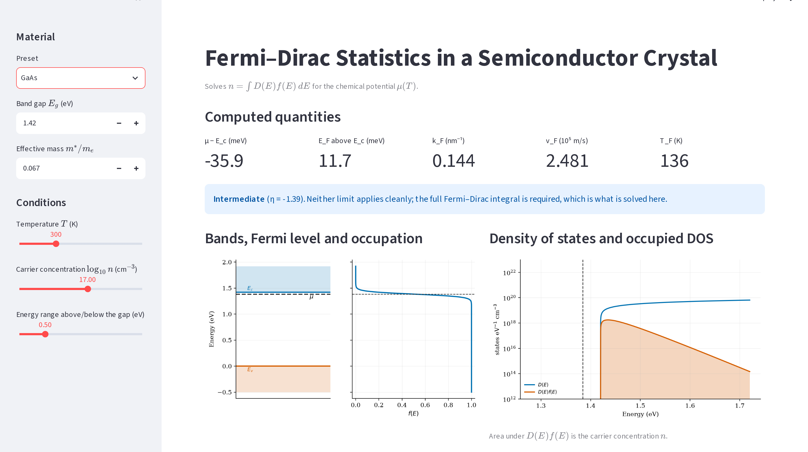

# Praveen: Q5 Interface (`app.py`, `_shots.py`)

**Your part:** `question_5/app.py` and `question_5/_shots.py`: the interactive interface, what
each control and output means, the warnings it shows, and how the report screenshots were taken.

Back to [README](../README.md) · read [THEORY.md](THEORY.md) for the physics the app shows.

## 1. 30-second version

> The Streamlit app takes the band gap, effective mass, temperature, carrier concentration and an
> energy range, with presets for GaAs, Si and Ge. It solves for μ with the full Fermi–Dirac
> integral and shows μ−E_c, E_F, k_F, v_F and T_F with a regime banner based on η. It warns when
> the inputs leave the model's range. Its plots are the band diagram with f(E), D(E) with its
> occupied part, and μ against T and against n. All the physics comes from `fermi.py`; the app
> reads inputs, calls it and draws the results. Nothing is approximated for speed; repeated
> inputs are cached.

## 2. Controls

| Control | Meaning |
|---|---|
| Preset | GaAs (1.42 eV, 0.067), Si (1.12, 1.08), Ge (0.66, 0.56). Masses are density-of-states masses |
| Band gap `E_g`, mass `m*/mₑ` | Editable; keyed on the preset (`key=f"eg_{preset}"`) so changing preset updates them |
| `T` slider | 1–1000 K |
| `log₁₀ n` slider | 12–20 (cm⁻³), steps of 0.1; above 19 is flagged as outside the model |
| Energy range | How far above/below the gap to draw |

Material data lives in one dict, `MATS`: for each preset, E_g, the DOS mass, the valley structure
`(M_c, m_l, m_t)` (Si: 6, 0.98, 0.19; Ge: 4, 1.64, 0.082; GaAs: none), the donor ionisation
energy `E_d`, and an approximate Mott density.

## 3. Outputs

- **Five metrics:** `μ−E_c` (meV), `E_F` above E_c (meV), `k_F` (nm⁻¹), `v_F` (10⁵ m/s), `T_F` (K).
  For the **Si and Ge presets** `k_F` is per valley and `v_F` is two numbers, along the long and
  short valley axes (`l / t`), because those Fermi surfaces are ellipsoids. If you edit the mass
  away from the preset value, it falls back to one isotropic sphere and says so.
- **Regime banner** from `η = (μ−E_c)/k_BT`:
  - `η > 2`: **degenerate** (green), so k_F, v_F, T_F describe real carriers.
  - `η < −3`: **non-degenerate** (amber), Boltzmann within 2 %; k_F, v_F, T_F are formal.
    (At η = −2 Boltzmann is still 4.7 % off, which is why the threshold is −3.)
  - otherwise **intermediate**: the full integral is needed.
- **Validity warnings.** n is an input and the model has no holes or donor levels, so some inputs
  describe states no real crystal is in. The app says so:
  - **Red error** if μ is within 3k_BT of E_v or below it. Example: Si, 1000 K, 1e12 puts μ
    0.51 eV *below* E_v. In a real crystal holes take over and μ is pinned near mid-gap.
  - A milder warning if μ is below mid-gap.
  - **Freeze-out** warning for the presets when fewer than 90 % of donors would be ionised,
    from `N_D⁺/N_D = 1/[1 + 2(n/N_c)e^{E_d/kT}]` (e.g. Si at 1e16 below about 135 K).
  - **Heavy doping** above 1e19, and for GaAs once μ comes within 3k_BT of the L valley.
- **Left plot:** band edges and μ, next to `f(E)` on the same energy axis.
- **Right plot:** `D(E)` and `D(E)f(E)` on a log axis; the area under D·f is n.
- **Two sweeps:**
  - μ−E_c against T: the marker is the current T, the dotted line is E_F, and the caption notes
    that n is held fixed, so there is no freeze-out.
  - μ−E_c against n: the marker is the current n, and the region above 1e19 is shaded as
    beyond the model.



*The report run: GaAs, n=1e17, 300 K, η = −1.39 (intermediate: neither limit applies cleanly).
Screenshots predate the review fixes, so the banner wording and the Si/Ge k_F/v_F tiles look a
bit different in the live app; the GaAs numbers are the same.*

## 4. Software flow (be able to say it)

```
n = 10**log_n * 1e6            # cm⁻³ → m⁻³
mu  = mu_of(n, T, m_eff, Ec)   # cached wrapper around f.solve_mu
eta = f.degeneracy(mu, T, Ec)
q   = f.fermi_quantities(n, m_eff, valleys=valleys)
→ metrics, banner, validity warnings
→ plots with f.fermi_dirac and f.dos
→ sweeps: mu_sweep_T (90 temperatures), mu_sweep_n (81 densities), both cached
```

Design points to be able to explain:
- **Thin wrapper.** Every number comes from `fermi.py`.
- **`st.cache_data`** on `mu_of`, `mu_sweep_T` and `mu_sweep_n`. A sweep is 80–90 root-finds;
  caching means moving the energy-range slider doesn't redo them. This is caching, not
  approximation.
- **Dense energy grid near μ** (`energy_grid`): a uniform grid plus 600 points within 12k_BT of
  μ. At 1 K, k_BT is 86 μeV, far smaller than the uniform spacing, so without the patch the Fermi
  step would be drawn as a slope.
- **Valleys only for an unedited preset.** The anisotropic masses belong to the preset's DOS mass;
  if you change the mass they'd no longer be consistent, so the app drops them.
- **Units:** SI inside `fermi.py`; the app converts to eV (`ev()`), meV, nm⁻¹ and cm⁻³ for display.
- **`matplotlib.figure.Figure`, not pyplot**, so nothing leaks between reruns; `sys.path` is
  extended only once.
- The app also runs as a page of the combined `streamlit_app.py` at the repo root, which is why
  `st.set_page_config` is wrapped in `try/except`.

## 5. `_shots.py`: the report screenshots

- Uses **Playwright** to open the running app in headless Chromium (1500 × 2900 px, 2× scale).
- For each preset (GaAs, Si, Ge) it opens the first combobox in the sidebar, selects the preset,
  waits for Streamlit to finish rerunning (`settle`: network idle plus a few seconds), and saves
  a full-page screenshot as `figures/ui_gaas.png`, `ui_si.png`, `ui_ge.png`.
- `trim()` crops the blank area below the content, measuring only the main panel, because the
  sidebar is a full-height grey block that would defeat the crop.
- `ui_gaas_top.png` in the report is a top-of-page crop made separately; no script in the repo
  makes it.

## 6. Likely questions

- **What do the inputs do?** T and n change μ; m* sets N_c and the DOS; E_g only shifts E_c (it
  doesn't change μ−E_c).
- **Why does the banner use η?** η compares μ−E_c with k_BT: that is the actual criterion for
  degeneracy.
- **Why show k_F, v_F, T_F in the non-degenerate regime?** The question asks for them. We show
  them, flagged as formal.
- **Is anything approximated?** No: the full integral is solved for every new input. Repeated
  inputs are cached, not approximated.
- **Why the red error?** The inputs put μ at or below the valence band, which the model can't
  describe because it has no holes. The app says so rather than plotting nonsense.
- **Why two numbers for v_F in Si?** Each Si valley is an ellipsoid (m_l = 0.98, m_t = 0.19), so
  the Fermi velocity differs along the long and short axes.
- **Why do the Si/Ge masses differ from textbook "electron masses"?** They're density-of-states
  masses (valley degeneracy included); conductivity masses are smaller.
- **Why does μ−E_c not depend on E_g?** E_c is just the reference energy; only m*, n and T
  matter for μ−E_c.
- **How do you know the app is right?** `fermi.py` passes nine checks in `test_fermi.py`
  (Nithin), and the app's GaAs numbers match the report's tables.
- **How were the screenshots made?** `_shots.py` drives a headless browser with Playwright.

## 7. Run it yourself

```bash
cd question_5
../.venv/bin/streamlit run app.py
```
Demo route: GaAs, 300 K, log n = 16 → 17 → 19, and watch the banner go non-degenerate →
intermediate → degenerate. Switch to Si and note μ−E_c drops at the same n. Set T=1 and check
μ ≈ E_F. Then trigger each warning:
- valence band: Si, 1000 K, log n = 12;
- freeze-out: Si, 77 K, log n = 16;
- heavy doping: any preset at log n = 19.5.

Screenshots (needs `pip install playwright && playwright install chromium`):
```bash
../.venv/bin/streamlit run app.py --server.port 8520 &
../.venv/bin/python _shots.py
```
