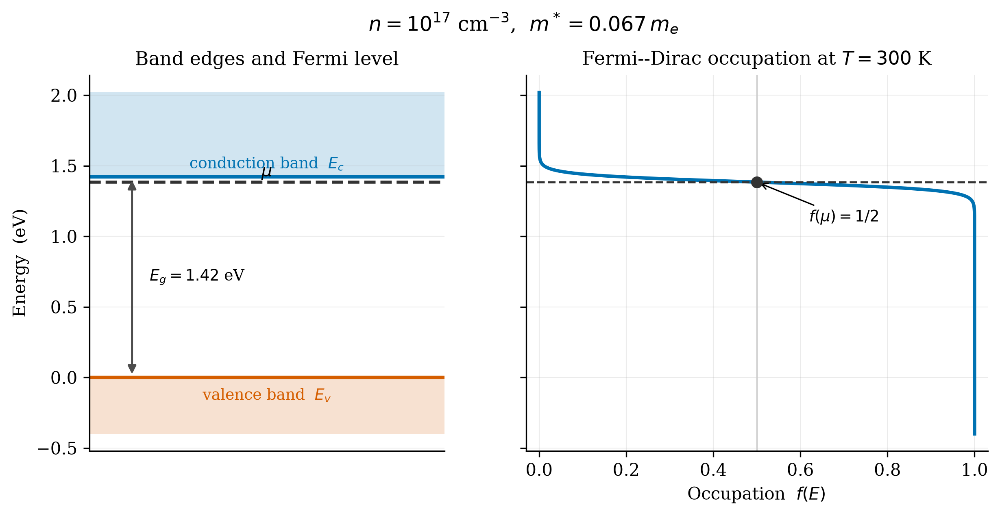
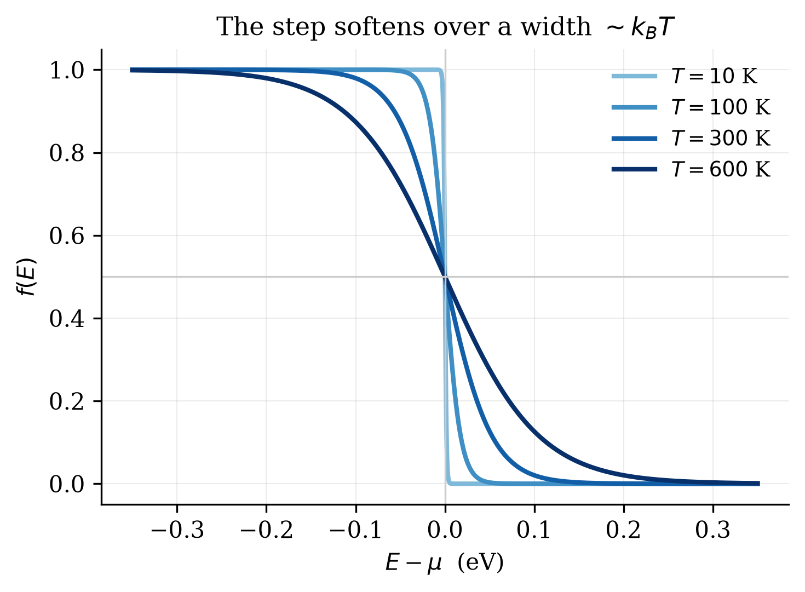
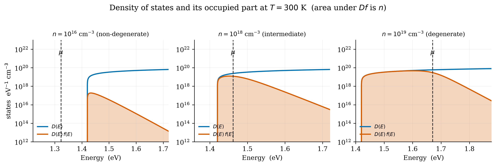
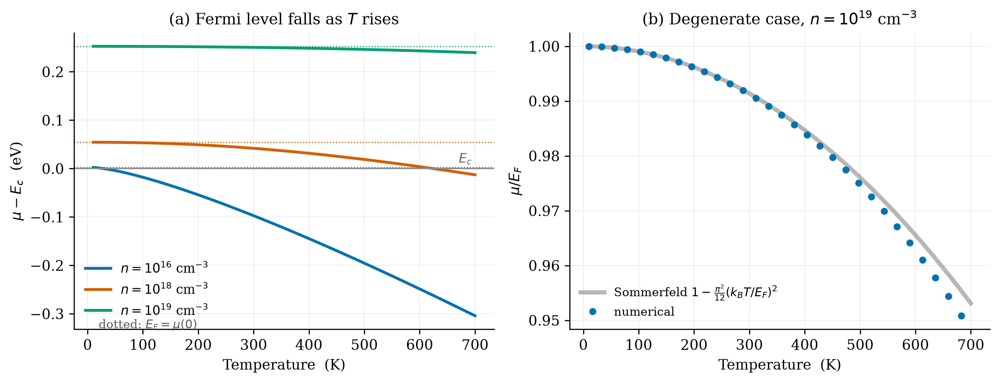
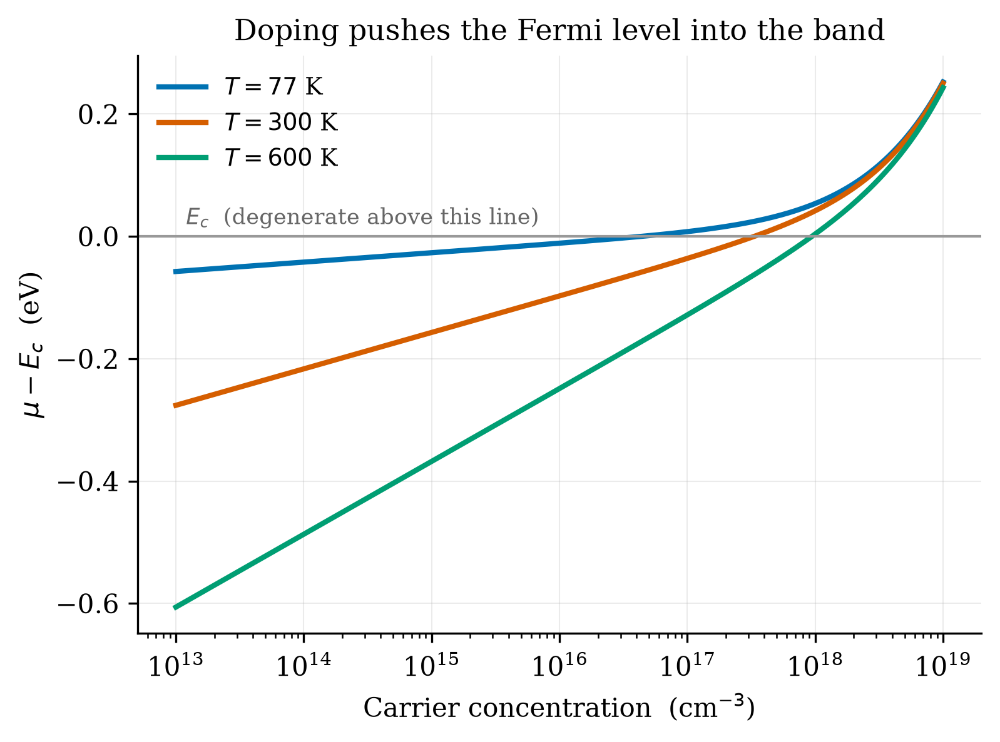

# Praveen: Q5 Results and Figures

**Your part:** `make_figures.py`, and report §Results: the three regimes, μ vs T, μ vs n,
materials comparison.

Back to [README](../README.md).

## 1. 30-second version

> All results come from one numerical solver. At fixed T=300 K, GaAs goes from classical
> (n=1e16, μ below the band edge) to degenerate (n=1e19, μ well above it), with n≈N_c=4.35e17 as
> the crossover. μ falls with T because D(E) grows with energy; in the degenerate case the fall is
> the small T² Sommerfeld correction. μ rises logarithmically with n, then as n^{2/3}. Effective
> mass, not band gap, decides how easily a material turns degenerate.

## 2. What `make_figures.py` generates

Reference material: GaAs-like (`E_g = 1.42 eV`, `m* = 0.067 mₑ`), reference `n = 1e17 cm⁻³`,
`T = 300 K`. Run `python make_figures.py`; it regenerates everything in `figures/`.

| Function | Output | Shows |
|---|---|---|
| `fig_bands` | `bands.png` | Band edges, μ, and `f(E)` on a shared energy axis; `f(μ)=1/2` |
| `fig_occupation` | `occupation.png` | `f(E)` smearing with T = 10, 100, 300, 600 K (μ held fixed) |
| `fig_dos` | `dos_occupied.png` | `D(E)` and `D(E)f(E)`, three regimes, log y-axis |
| `fig_mu_vs_T` | `mu_vs_T.png` | (a) μ(T) at three n; (b) degenerate case vs Sommerfeld |
| `fig_mu_vs_n` | `mu_vs_n.png` | μ−E_c vs n at three temperatures, 1e13 to 1e19 (the model's limit) |

## 3. Results to know cold

### Three regimes (GaAs, 300 K)

| n (cm⁻³) | μ−E_c (meV) | η | E_F (meV) | T_F (K) | Regime |
|---|---|---|---|---|---|
| 1e16 | −97.3 | −3.77 | 2.5 | 29 | classical (μ below edge) |
| 1e18 | +41.9 | 1.62 | 54.4 | 632 | intermediate (full integral needed) |
| 1e19 | +250.4 | 9.69 | 252.6 | 2931 | degenerate (μ ≈ E_F to within 1%) |


*n=1e17: μ sits below E_c; f passes through ½ exactly at μ.*


*Step softens over ~k_BT: nearly sharp at 10 K, smeared over >0.2 eV at 600 K. μ is held fixed
here on purpose to show only thermal broadening.*


*Log axis needed: at 1e16 the occupied DOS is ~4 orders below D(E). Non-degenerate: D·f is a
straight line down (Boltzmann tail). Degenerate: D·f follows D up to μ, then drops within a few
k_BT. The area under D·f is n.*

### μ vs T


- μ **falls** with T: D(E) ∝ √(E−E_c) puts more states above μ than below within the thermal window,
  so carriers promoted upward force μ down to keep n fixed. At low doping μ drops below E_c.
- Degenerate case is much flatter: `μ ≈ E_F[1 − (π²/12)(kT/E_F)²]`. Numerics follow this up to
  ~300 K, 0.5% off at 700 K where `kT/E_F ≈ 0.24`, the asymptotic series' expected failure.

### μ vs n


- Non-degenerate: `μ = E_c + kT ln(n/N_c)`, logarithmic in n.
- Crosses E_c near `n ≈ N_c = 4.35e17 cm⁻³` (GaAs, 300 K).
- Degenerate: `μ ∝ n^{2/3}` (from E_F), much steeper.
- Higher T shifts the crossing to higher n because `N_c ∝ T^{3/2}`.

### Different materials (n=1e17, 300 K)

| Material | E_g (eV) | m*/mₑ | μ−E_c (meV) | η |
|---|---|---|---|---|
| GaAs | 1.42 | 0.067 | −35.9 | −1.39 |
| Si | 1.12 | 1.080 | −145.8 | −5.64 |
| Ge | 0.66 | 0.560 | −120.3 | −4.65 |

Ordering follows m*, via `N_c ∝ (m*)^{3/2}`, not E_g (the gap only sets where E_c is). Light mass
→ few states → carriers fill higher → closer to degenerate. Masses are *density-of-states* masses
(valley degeneracy already included: Si 6 valleys, Ge 4), so don't multiply N_c by the
degeneracy again.

### Why doping stops at 1e19

At 1e20, E_F ≈ 1.17 eV above E_c, far above GaAs's L and X valleys (0.29 and 0.48 eV), so the
single-parabolic-valley model no longer describes the band structure. The `mu_vs_n` figure
therefore stops at 1e19 (it used to run to 1e21), and the app flags anything above 1e19. Even
1e19 is the edge: μ is 250 meV above E_c there, within 40 meV of the L valley.

## 4. Likely questions

- **Why a log axis in the DOS figure?** D·f at 1e16 is ~1e-7 of D; on a linear axis it would look
  like zero.
- **Why does μ fall with T?** (See above: D(E) grows with E.) Not "electrons go to higher
  energy" alone.
- **Why is the occupation figure at fixed μ?** To isolate thermal broadening; the true μ(T) at
  fixed n also moves.
- **What is the clipping at 1e10 in the DOS plot?** A floor on the log axis for plotting only; the
  physics decays smoothly to zero.
- **Why do Si and Ge look more classical than GaAs at the same n?** Larger m* → larger N_c.
- **What happens to μ as T→0?** In the model, μ → E_c + E_F for any n (shown in the T-sweep
  tests). In a real lightly doped crystal the donors recapture their electrons (freeze-out) and
  μ stays between the donor level and E_c. The model holds n fixed, so it can't show that; the
  app warns when it would matter.
- **What happens at very low n and high T?** The fixed-n model can push μ below the valence band
  (Si, 1000 K, 1e12: 0.51 eV below E_v). Physically the intrinsic density is then far above n
  and holes take over; the model has no holes, so the app shows an error instead.
- **What's the area under D·f?** The carrier density n.
- **Which result would change for p-type?** Would need the valence-band DOS and hole density, which
  are outside this model.

## 5. Run it yourself

```bash
cd question_5
../.venv/bin/python make_figures.py          # regenerates all PNGs
../.venv/bin/streamlit run app.py            # pick GaAs, sweep log10 n from 16 to 19
```
Move the `log10 n` slider and watch the banner flip classical → intermediate → degenerate and the
`μ vs n` marker travel along the curve.
